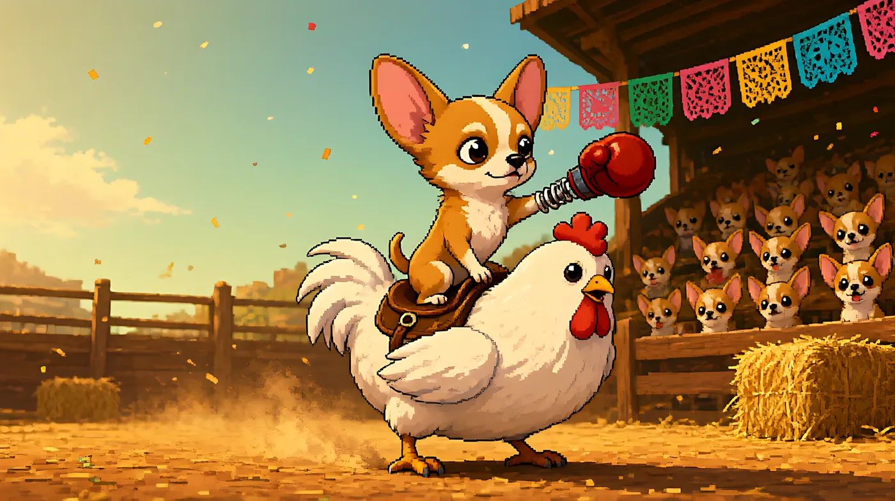
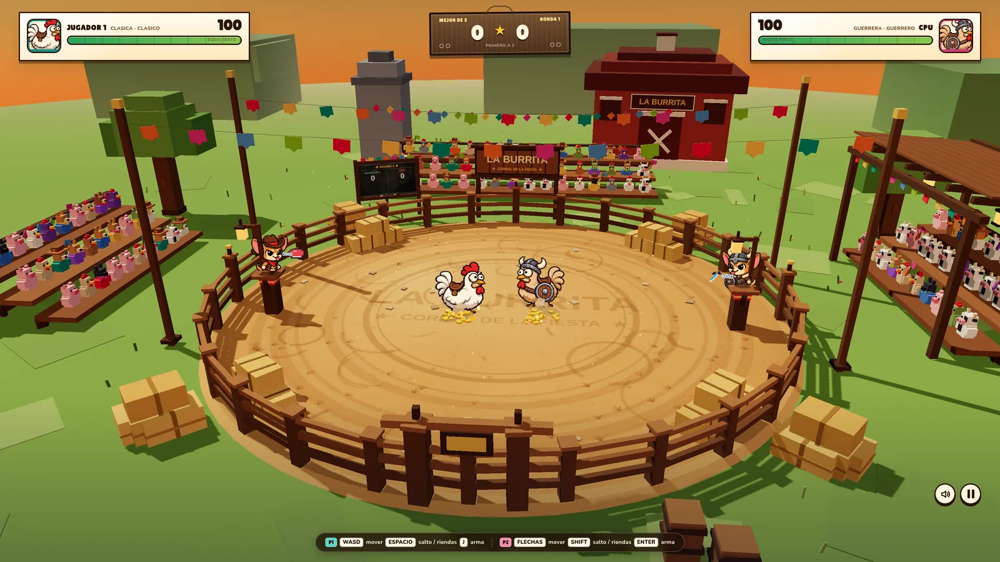
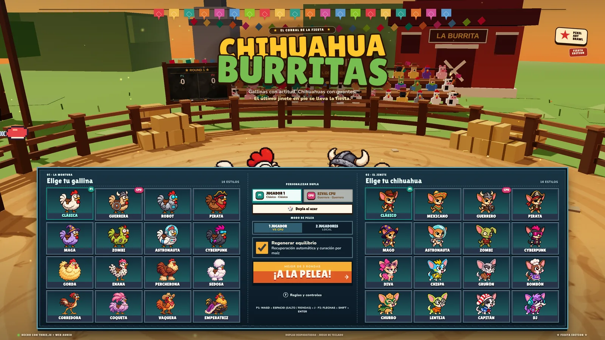
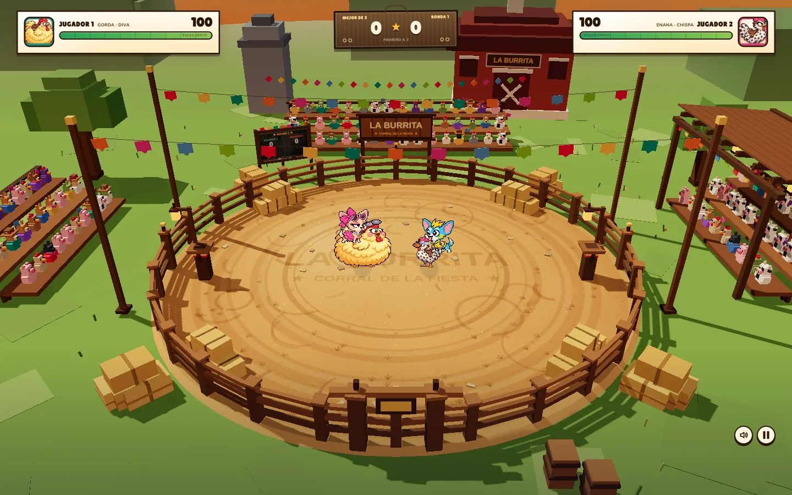
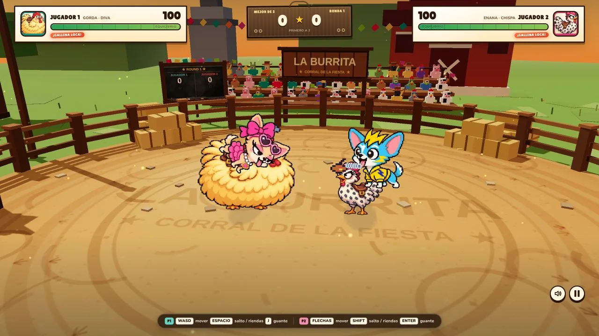

<div align="center">



# Chihuahua Burritas

**Gallinas con actitud. Chihuahuas con guantes. El último jinete en pie se lleva la fiesta.**

Un brawler de fiesta en pixel art: 16 gallinas, 16 chihuahuas y un ruedo 3D.
Mejor de tres rondas, contra la CPU o con dos jugadores en el mismo teclado.

[**Jugar en el navegador**](https://neshack.github.io/chihuahua-burritas/) ·
[Descargar para Linux](https://github.com/neshack/chihuahua-burritas/releases) ·
[Documentación](docs/) ·
[Licencia MIT](LICENSE)


</div>

---

## Qué es

Cada ronda es una pulseada sobre una gallina desbocada. No hay barra de vida: hay **equilibrio** de 0 a 100.
Los golpes, los rebotes contra la valla y los choques lo bajan. Cuando llega a cero, el chihuahua sale volando,
la gallina corre asustada y la ronda termina.

- **32 personajes**: 16 gallinas y 16 chihuahuas, combinables antes de pelear.
- **Mejor de 3 rondas**: gana quien se lleve dos.
- **Uno o dos jugadores**: contra la CPU o en el mismo teclado.
- **Arte generado**: corral 3D en Three.js, luchadores en Canvas 2D y audio sintetizado con Web Audio.
- **Sin assets externos**: no hay modelos 3D, archivos de audio ni arte de terceros.

## Capturas

| Combate | Selección de duplas |
| --- | --- |
|  |  |

| El ruedo completo | Personalidades |
| --- | --- |
|  |  |

## Ejecutar

Requiere Node.js 20 o superior y un navegador con WebGL.

```bash
npm install
npm run dev
```

Abre la URL que imprime Vite (por defecto `http://localhost:5173`). Para producción:

```bash
npm run build
npm run preview
```

## Controles

| Acción | Jugador 1 | Jugador 2 local |
| --- | --- | --- |
| Mover | `W` `A` `S` `D` | Flechas |
| Saltar / riendas | `Espacio` | `Shift` |
| Atacar | `J` | `Enter` |
| Pausa | `Esc` o `P` | `Esc` o `P` |
| Silencio | `M` | `M` |

El botón de sonido del HUD hace lo mismo que `M` y la preferencia se guarda en el navegador.
La pelea está pensada para teclado y pantalla amplia; en móvil el menú funciona, pero no hay controles táctiles.

## Reglas en treinta segundos

1. Golpea con el guante. Recarga en 1.5 segundos y, si fallas, pierdes 10% de equilibrio.
2. Busca el flanco o la espalda: el daño se duplica y no devuelve retroceso.
3. Usa las vallas y las pacas para rebotar; el impacto también resta equilibrio.
4. Aletea para reducir la fricción y pisa al rival desde el aire.
5. Come maíz para recuperar equilibrio y ganar turbo, o desactiva la regeneración en el menú.

El detalle completo está en [Controles y reglas](docs/CONTROLES-Y-REGLAS.md).

## Personajes

- **Gallinas**: Clásica, Guerrera, Robot, Pirata, Maga, Zombi, Astronauta, Cyberpunk, Gorda, Enana, Percherona, Sedosa, Corredora, Coqueta, Vaquera y Emperatriz.
- **Chihuahuas**: Clásico, Mexicano, Guerrero, Pirata, Mago, Astronauta, Zombi, Cyberpunk, Diva, Chispa, Gruñón, Bombón, Churro, Lenteja, Capitán y DJ.

Todas las armas comparten daño, alcance y recarga; lo que cambia es la silueta, el accesorio y la burla.
El catálogo con personalidades y armas está en [Personajes](docs/PERSONAJES.md).

## Arquitectura

```text
src/
  main.js                     arranque de Vite
  game/game.js                máquina de estados, rondas, cámara y combate global
  game/dupla.js               física de la dupla, input, animación y KO
  game/ai.js                  FSM PATROL → ALIGN → CHARGE → RECOVER
  game/arenaFraming.js        encuadre del ruedo por resolución
  characters/pixelSprites.js  carga y recorte de atlas
  characters/pixelMotion.js   patas articuladas y fases de paso
  characters/pixelExpressions.js  ojos, bocas y estados de ánimo
  characters/pixelWeapons.js  armas dibujadas en píxeles
  characters/thumbnails.js    retratos de selección
  world/arena.js              corral, gradas, público, vallas y papel picado
  world/voxel.js              constructor de cubos y geometría fusionada
  world/skins.js              paletas y datos de las 32 variantes
  core/audio.js               sintetizador Web Audio (efectos y música)
  core/particles.js           partículas instanciadas
  core/input.js               teclado y clic
  ui/UI.js                    menú, HUD, anuncios y overlays
  styles.css                  sistema visual de fiesta
```

Decisiones técnicas, flujo de estados y notas de rendimiento en [Arquitectura](docs/ARQUITECTURA.md).
Cómo levantar el proyecto, probarlo y empaquetarlo en [Desarrollo](docs/DESARROLLO.md).

## Pruebas

```bash
npm test
```

Ocho archivos cubren catálogo, regeneración, animación, expresiones, rig, cámara y el ejecutable de Linux.
La prueba del ejecutable se omite si el binario no está construido.

## Ejecutable para Linux

El ejecutable vive en la página de [Releases](https://github.com/neshack/chihuahua-burritas/releases), no en el
repositorio: pesa unos 152 MB y supera el límite de GitHub para archivos versionados. Incluye Node y el lanzador.

Para generarlo desde el código fuente, en Linux x86-64 con Node.js 25.5 o posterior:

```bash
npm install
npm run build:linux
```

El resultado queda en `ejecutable/Chihuahua-Burritas`. Abre una ventana con Chrome, Chromium o Brave;
si no encuentra ninguno, usa el navegador predeterminado.

## Sitio y despliegue

La landing vive en `site/`. Para armarla junto con el juego compilado:

```bash
npm run site
```

Eso genera `_site/` con la landing en la raíz y el juego en `jugar/`. El flujo de GitHub Actions
[`pages.yml`](.github/workflows/pages.yml) publica ese directorio en GitHub Pages en cada push a `main`.
Los pasos manuales están en [Publicar](docs/PUBLICAR.md).

## Documentación

- [Arquitectura](docs/ARQUITECTURA.md)
- [Controles y reglas](docs/CONTROLES-Y-REGLAS.md)
- [Personajes](docs/PERSONAJES.md)
- [Desarrollo](docs/DESARROLLO.md)
- [Publicar](docs/PUBLICAR.md)
- [Arte de personajes](docs/pixel-art.md)
- [Cómo contribuir](CONTRIBUTING.md)

## Créditos

Hecho por [Nestor Peña](https://github.com/neshack). El corral, la física, el audio y la interfaz son código original.
Las hojas de sprites se generaron con herramientas de imagen por IA y se integraron como atlas transparentes;
los prompts y el método están en [Arte de personajes](docs/pixel-art.md).

## Licencia

[MIT](LICENSE). Puedes estudiar, modificar y reutilizar el código, los sprites y el audio citando la autoría.
